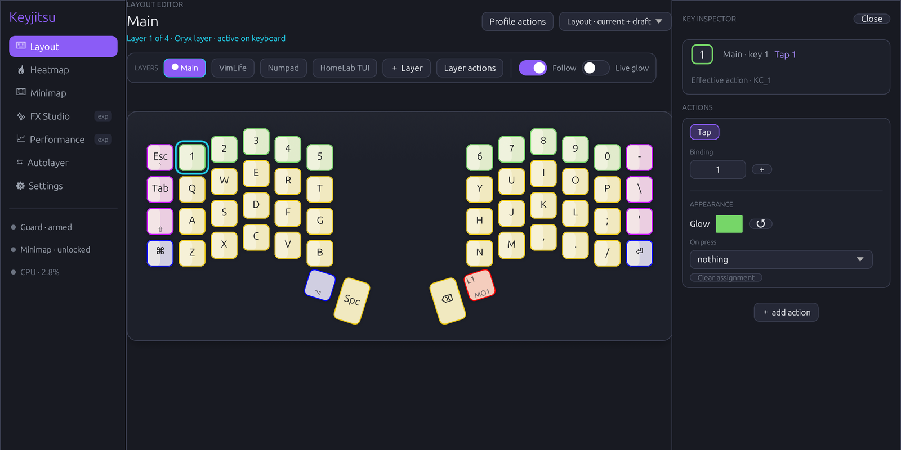
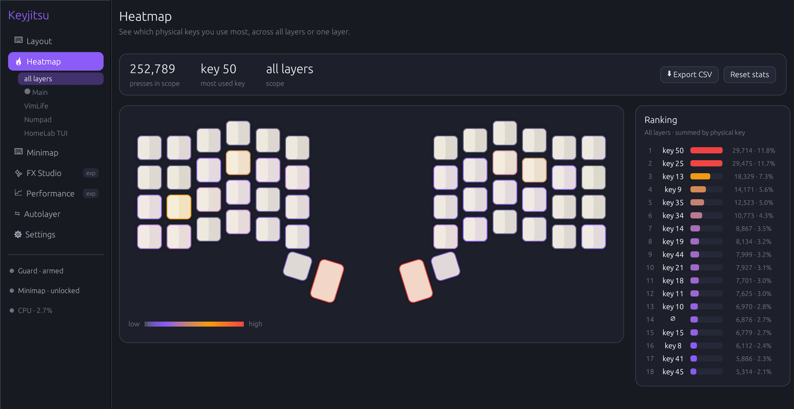
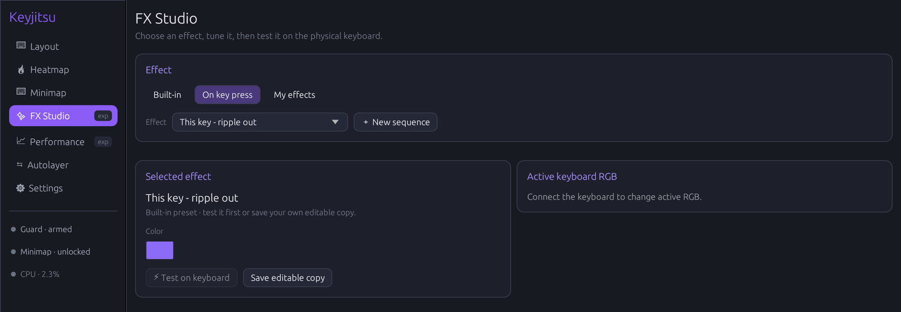
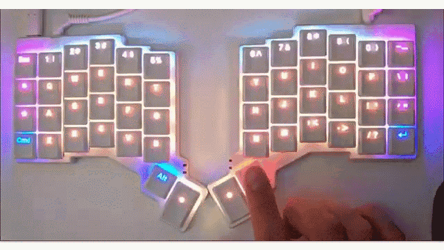
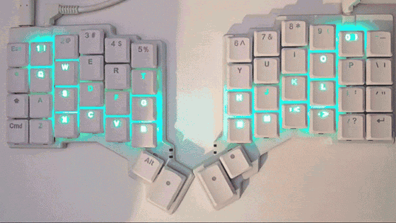
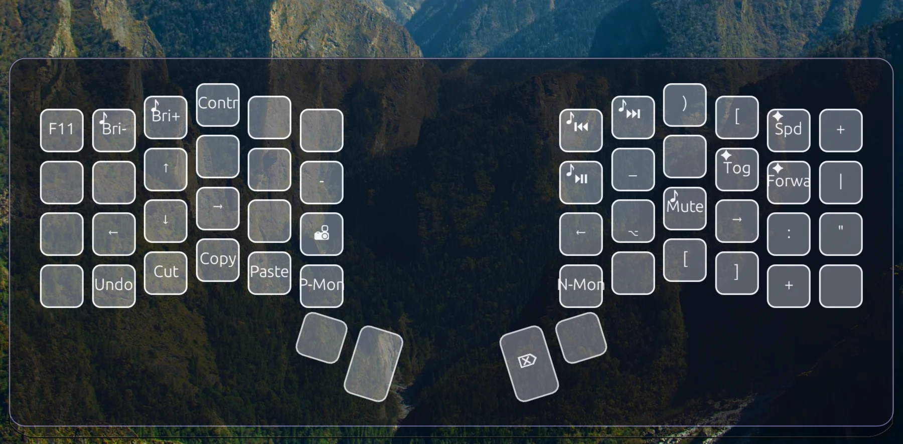

# Keyjitsu

[](https://github.com/martinezooo/keyjitsu/actions/workflows/ci.yml)
[](LICENSE)

**A local keyboard manager for the [ZSA Voyager](https://www.zsa.io/voyager), built for macOS.**

View your layers, remap keys, set up RGB effects, track key usage and build QMK firmware without leaving the app. Keyjitsu can read your existing Oryx layout; edits and firmware builds stay on your computer. No account or background daemon.

**[Download for macOS (Apple Silicon)](https://github.com/martinezooo/keyjitsu/releases)** · [Install and update](#install) · [Build from source](#build-from-source)



Keyjitsu is still in beta. The Voyager is the only keyboard tested so far, and macOS is the primary supported platform. Linux and Windows builds are experimental. Quit Keymapp before connecting to Keyjitsu: the raw HID channel can only be used by one app at a time.

## Screenshots

### Heatmap

Key usage by layer or across the whole keyboard, with a ranking and CSV export.



### FX Studio

Set an effect for key presses or create an RGB sequence. FX Studio is experimental.



### On the keyboard

Two recordings from a physical Voyager. The first shows a key-press lighting effect; the second shows a longer RGB animation. The recordings show lighting on the actual keyboard.

**Key-press effect**



**RGB animation**



### Minimap

A transparent layer reference that stays above your other windows and can ignore mouse input.



## Features

Start Keyjitsu from Applications or run `keyjitsu` in Terminal. Use profiles to save different keyboard setups and switch between them.

- **Layout editor.** Your layout with Oryx legends and live key feedback.
  Click a key to edit its four slots (tap, hold, double tap, tap+hold), pick
  keycodes from an Oryx-style picker, set a per-key glow color and an on-press
  effect, then hit Build & flash. Firmware is compiled locally, and double-tap
  or tap+hold become generated QMK tap dances. Staged edits survive restarts
  (shown as pending) until you build.
- **Heatmap.** Per-layer or summed press counts, a ranking, and CSV export.
- **Minimap.** A transparent overlay that shows the current layer's keys,
  so you can glance at what a layer does without leaving what you are doing. It
  appears when you switch layers (and can stay up the whole time you are on a
  non-base layer), floats click-through over everything; on macOS you can choose any monitor, and can
  be summoned by holding a key or chord on the Voyager.
- **FX Studio** (experimental). Build and test RGB effects: built-in constant
  and press effects, plus a step sequencer for your own (paint keys, duplicate
  a step, nudge it around the board, loop). Apply to the whole board, or per
  key from the editor's on-press slot. Board RGB survives restarts.
- **Performance** (experimental). keyjitsu samples its own CPU, tagged by what
  it was doing.
- **Autolayer.** Switch layers by the frontmost app, matched on the bundle id.
- **Settings.** Local QMK toolchain status and firmware build, the keyboard
  guard, start-at-login, the update check, and a shortcut library
  (a reference list of ~160 common shortcuts to borrow from, with your own
  entries and hideable built-ins).

The connection auto-reconnects on unplug, replug, and after flashing.

## Keyjitsu and ZSA's tools

[Oryx](https://configure.zsa.io) is ZSA's web-based layout editor; [Keymapp](https://blog.zsa.io/keymapp/) is its desktop companion. Keyjitsu is an independent alternative for the Voyager. It reads an Oryx layout, lets you edit it locally, and can compile and flash firmware using the ZSA QMK fork.

Changes made in Keyjitsu are not sent back to Oryx. If you flash firmware from Oryx again, it replaces the layout previously built by Keyjitsu. The [firmware state notes](#device-state-oryx-and-mixing-workflows) explain how Keyjitsu keeps track of this.

## CLI

The CLI covers the core device, layout, heatmap, RGB, build and flash workflows. A few commands:

| Command | What it does |
| --- | --- |
| `keyjitsu list` | List connected ZSA keyboards |
| `keyjitsu status` | Connection, protocol/firmware version, active layer |
| `keyjitsu live` | Full-screen TUI live view (legends, heatmap overlay, layer browsing) |
| `keyjitsu layout` | Print every layer with legends (`--layer N`, `--json`, `--url`, `--refresh`) |
| `keyjitsu watch` | Stream key/layer events (`--json` for scripting) |
| `keyjitsu heatmap show/reset` | Render or clear collected stats |
| `keyjitsu layer set/unset N` | Switch layers from scripts |
| `keyjitsu rgb set/all/release` | Per-key or whole-board RGB |
| `keyjitsu build-local` | Compile firmware locally (`--set "L,POS=KC_X"`, `--dance "L,POS=TAP,HOLD,DOUBLE,TAPHOLD"`) |
| `keyjitsu flash <file\|url>` | Flash a `.bin` or an Oryx URL (`--latest` for the newest revision) |
| `keyjitsu guard` | Disable the built-in Mac keyboard while a ZSA board is connected (Ctrl+C restores) |

Add `--serial <substr>` to pick one of several keyboards.

## Local firmware builds

On macOS, see **[QMK setup and troubleshooting](docs/QMK_MACOS.md)**. The guide covers a fresh Mac, ARM GCC, the ZSA `firmware25` checkout and recent Homebrew tap-trust errors.

You can check the local prerequisites without changing anything:

```sh
scripts/check-qmk-macos.sh
```

Firmware builds use the `zsa/qmk_firmware` fork, a working `qmk` CLI and `arm-none-eabi-gcc`. The compiler and firmware checkout are separate from installing Keyjitsu itself.

Settings shows a green "Ready" pill once the toolchain is in place. A build
fetches your layout's generated source from Oryx once (cached, offline
afterwards), patches the keymap with your staged edits, generates any tap
dances, compiles with `qmk`, and flashes over the Voyager's bootloader. No ZSA
account needed.

Your edits live in that local firmware, not in Oryx. keyjitsu only reads your
base layout from Oryx (anonymously). A Keyjitsu-built firmware carries a compact
state id in the firmware serial, so after reconnect or app restart Live
reconstructs the exact Keyjitsu-authored state reported by the keyboard instead
of treating the last saved app config as device truth. It never writes back to
the portal. So remapping here does not carry over to Oryx, and re-flashing from
Oryx later would overwrite your Keyjitsu changes.

## Device state, Oryx, and mixing workflows

There is an important limitation in ZSA's current Oryx raw-HID protocol:
**stock Oryx firmware does not expose the complete keymap back to the desktop
app**. The keyboard can report runtime information and its firmware identity
(`layout-hash/revision-hash`), but there is no supported HID command that
returns every key assignment, layer definition, combo, and persistent RGB
setting from the compiled firmware.

For stock Oryx firmware, keyjitsu can use the `hash/revision` reported by the
physical keyboard to load the matching Oryx layout. That is a reconstruction
from Oryx data selected by the device's own revision id; it is **not** a full
keymap extracted from the firmware image itself.

Keyjitsu-built firmware adds its own compact state id to the firmware serial.
That lets keyjitsu reconstruct the exact Keyjitsu-authored additions from its
matching local firmware-state record. It still does not make stock Oryx
firmware suddenly readable as a complete keymap.

### Practical rule: pick one source of authoring truth

For the least surprising workflow, use **either Oryx or keyjitsu as the main
place where you author a keyboard configuration**.

- If you edit and flash in Oryx, treat that Oryx revision as the source of
  truth. Keyjitsu can recognize the revision reported by the keyboard and load
  the corresponding Oryx layout.
- If you edit and flash in keyjitsu, treat the Keyjitsu firmware state as the
  source of truth. Those local-only edits are not written back to Oryx.
- Re-flashing from Oryx overwrites Keyjitsu-only firmware changes.
- Re-flashing from keyjitsu does not update your Oryx layout.
- Switching between the two workflows is possible, but save the configuration
  you want to keep before flashing and expect the two representations to
  diverge unless you deliberately synchronize them.

Live/device status should always be driven by the **currently connected
keyboard's identity**. A saved layout or restore point must never silently
replace what Live claims is on the physical keyboard.

## How it works

- **Protocol.** ZSA's open Oryx raw-HID protocol v4 (32-byte reports, usage
  page `0xFF60`), as published in [zsa/qmk_modules](https://github.com/zsa/qmk_modules).
- **Layout state.** Stock Oryx firmware identifies itself as `hash/revision`.
  Keyjitsu-built firmware extends that identity with a local state id. The base
  revision is fetched from the Oryx GraphQL API and the exact Keyjitsu changes
  are reconstructed from the matching local firmware-state record.
- **Flashing.** Uses ZSA's own open-source [zapp](https://github.com/zsa/zapp)
  (`zapp-core`, MIT + Commons Clause) for the DFU/Ignition bootloaders and dual
  STM32+GD32 images. You press the reset button, then keyjitsu waits and flashes.
- **Guard.** Remaps the built-in keyboard's keys to no-ops with `hidutil` (no
  special permission needed). It can't lock you out: the built-in comes back
  around the lock screen and after any reboot, and is restored on toggle-off,
  disconnect, and quit. Engaged only while a ZSA keyboard is present.
  keyjitsu verifies with hidutil itself that the remap actually applied
  (rather than trusting a successful exit code), and Settings has a
  **"Test the guard"** button that listens system-wide for a moment to
  confirm no key press gets through. On some Macs, hidutil's remap reaches
  the keyboard's "Service" HID layer but not a separate raw "Device" layer
  that can still deliver key presses: run the test on your own Mac if you
  plan to rely on the guard, and don't treat it as absolute.
- **Storage.** State is kept in the platform data directory returned by the OS (`~/Library/Application Support/keyjitsu/` on macOS, the corresponding user data directory on Linux/Windows): `config.json`, `profiles/*.json`, `firmware-states/*.json`, heatmap stats, and cached layouts/sources. Settings can export those portable items to a bounded ZIP and restore them on a controlled restart; conflicting local files are preserved, while unrelated logs, recordings and signing material are excluded. Before a first real layout has been cached, the GUI displays ZSA's official Voyager default layout (`E5AmY/B495Jd`) as a bundled offline fallback; it is never flashed automatically and a connected keyboard always replaces it with its own layout.

## Install

### Release downloads

For **macOS on Apple Silicon**, select the latest **Signed macOS** prerelease
from [GitHub Releases](https://github.com/martinezooo/keyjitsu/releases).
Download the DMG and drag Keyjitsu.app into Applications. These dedicated
macOS packages are Developer ID signed, notarized by Apple and verified by
Gatekeeper. Each release also contains a ZIP and `SHA256SUMS.txt`.

Starting with **0.10.0-beta.5**, Settings checks signed macOS prereleases in
addition to the normal version history. If a newer signed build is available,
select **Download and verify update**. The app checks the GitHub SHA-256,
Developer ID identity, bundle ID, and Apple notarization, then offers **Install
update and restart**. It never replaces the app without your confirmation.
The updater preserves settings, profiles, heatmaps, and firmware data, and
attempts to roll back if activation fails. Installing in a folder without
write permission requires a manual DMG install.

**One-time migration:** versions through beta.4 used an update checker that
missed beta releases. Install a recent signed DMG manually once. Versions
from beta.5 onward can detect signed macOS prereleases in Settings.

The cross-platform workflow still produces ad-hoc signed macOS development
artifacts. Use the **Signed macOS** downloads for normal installation. Linux
and Windows releases are experimental.

### Build from source

You need [Rust](https://rustup.rs). The QMK toolchain is only needed for local firmware builds.

```sh
cargo install --git https://github.com/martinezooo/keyjitsu
```

Run `keyjitsu` for the GUI or `keyjitsu list` for the CLI.

For the macOS app bundle:

```sh
git clone https://github.com/martinezooo/keyjitsu
cd keyjitsu
scripts/bundle.sh --install
```

A plain `cargo build --release` builds the desktop/CLI binary on supported desktop targets. Linux needs the normal hidapi/udev development packages at build time and udev access to the Voyager HID device at runtime.

macOS remains the primary hardware-tested target. Guard and Autolayer are macOS-only. Peek works on all desktop targets, but multi-monitor enumeration is currently macOS-specific; Windows/Linux use the current-display fallback until native monitor enumeration is validated.

## Privacy and network

keyjitsu has no accounts, no telemetry, and no background services. It talks
to exactly two places on the network, and both are easy to find in the source:

- `oryx.zsa.io`: an anonymous, read-only fetch of your layout (for the legends),
  cached on disk after the first time. Local firmware builds fetch the layout's
  generated source the same way, once. It never writes to Oryx.
- `api.github.com`: a bounded list of release metadata, once at startup
  (Settings can disable this) and on demand. With your explicit permission,
  the macOS updater downloads a verified signed ZIP from `github.com`
  (which can redirect to GitHub's asset CDN). No telemetry or silent updates.

On macOS, the keyboard guard uses the system `hidutil` tool. Persistent files live in the platform user data directory selected by the `directories` crate; the app does not write system-wide state.

## Uninstall

Quit the app, then:

```sh
rm -rf /Applications/Keyjitsu.app
rm -f ~/Library/LaunchAgents/com.keyjitsu.gui.plist    # only if start-at-login was on
rm -rf ~/Library/Application\ Support/keyjitsu         # settings, profiles, caches
```

If the guard was on and the app was force-killed, a reboot restores the
built-in keyboard, and so does this command:

```sh
hidutil property --matching '{"Product":"Apple Internal Keyboard / Trackpad"}' --set '{"UserKeyMapping":[]}'
```

## Support

Keyjitsu is a free personal project. Bug reports and practical feedback are welcome.
If you want to support development, there is
[GitHub Sponsors](https://github.com/sponsors/martinezooo) and
[Ko-fi](https://ko-fi.com/martinezooo).

## Acknowledgements

Keyjitsu stands on open work from ZSA and the QMK community, and on the Rust
ecosystem. It does not reimplement what those projects already do well.

- **ZSA.** The Voyager itself, the open Oryx raw-HID protocol
  ([zsa/qmk_modules](https://github.com/zsa/qmk_modules)) that keyjitsu speaks,
  the public read-only Oryx layout API it reads anonymously, and the open-source
  [zapp](https://github.com/zsa/zapp) flasher (`zapp-core`), which keyjitsu links
  for the actual firmware flashing rather than rolling its own.
- **QMK.** Local builds use the standard [QMK](https://qmk.fm) toolchain and
  ZSA's `qmk_firmware` fork. The generated tap dances follow QMK's own idiom.
- **Rust crates.** [eframe / egui](https://github.com/emilk/egui) for the GUI,
  [ratatui](https://github.com/ratatui/ratatui) and crossterm for the TUI,
  [hidapi](https://crates.io/crates/hidapi) for USB HID, plus serde, ureq,
  clap, anyhow, zip, ctrlc, directories, and objc2 / core-foundation on macOS.
  See `Cargo.toml` for the full list and versions.

The protocol is implemented from ZSA's public spec, and layout data comes
through the public Oryx API. Keyjitsu is an independent project, not affiliated
with or endorsed by ZSA.

## License

MIT (see [LICENSE](LICENSE)). Firmware flashing links ZSA's `zapp-core`, which
is MIT + Commons Clause (no reselling its functionality), so keep that in mind
if you redistribute. The bundled symbol font is Noto Sans Symbols 2
(SIL OFL 1.1).
