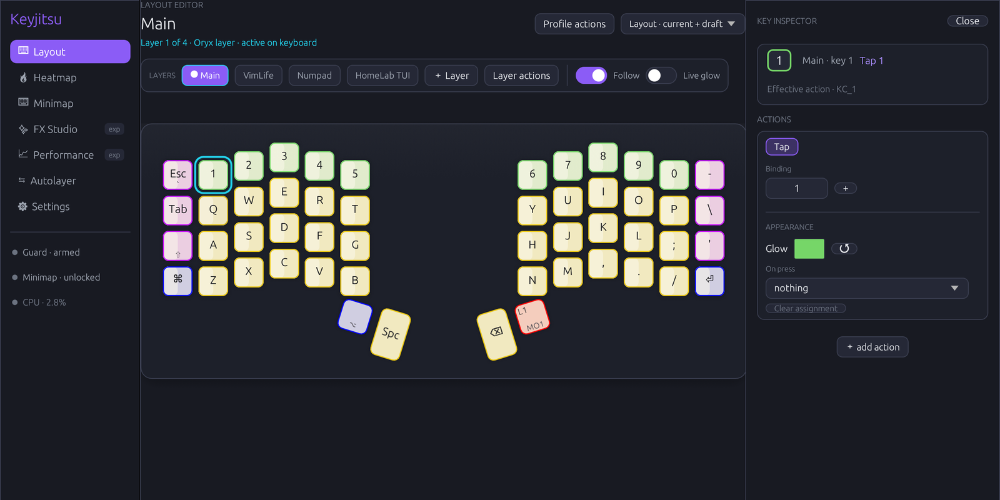
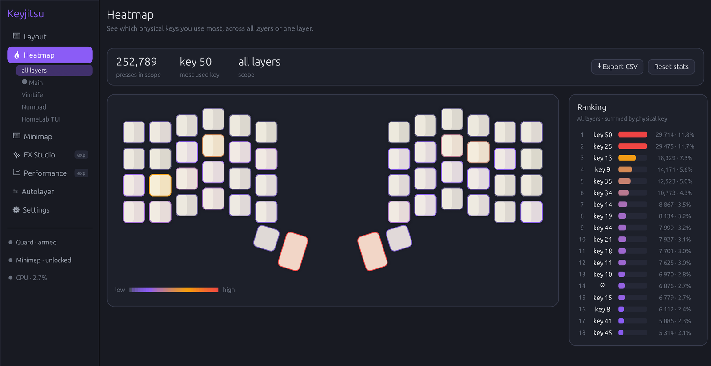
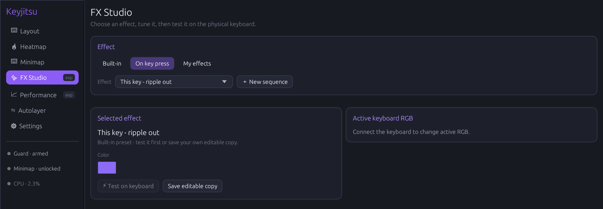
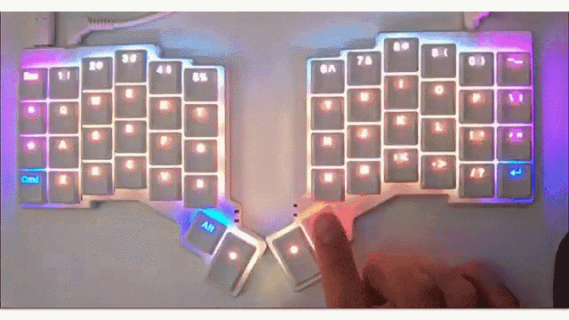
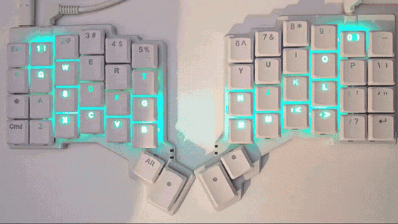
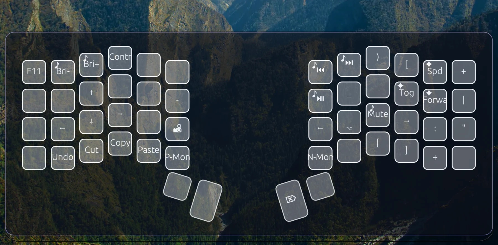

# Keyjitsu

[](https://github.com/martinezooo/keyjitsu/actions/workflows/ci.yml)
[](LICENSE)

A local keyboard manager for the [ZSA Voyager](https://www.zsa.io/voyager). View and edit layers, customize RGB lighting, track key usage and build QMK firmware on your own computer.

**[Download 0.10.0-beta.7](https://github.com/martinezooo/keyjitsu/releases/tag/signed-macos-v0.10.0-beta.7-50f93f9)** · [Installation](#installation) · [All releases](https://github.com/martinezooo/keyjitsu/releases)



## Platform support

| Platform | Architecture | Status | Distribution |
| --- | --- | --- | --- |
| macOS | Apple Silicon (arm64) | Primary, hardware-tested | Signed and notarized DMG / ZIP |
| Linux | x86_64 | Experimental | TAR.GZ |
| Windows | x86_64 | Experimental | ZIP |

Keyjitsu is in beta. CI builds, lints and tests all three platforms, but live Voyager testing has focused on macOS. Linux and Windows USB access, firmware flashing and desktop integration still need hardware validation. Other architectures and keyboards are not officially supported.

Quit ZSA Keymapp before connecting: the raw HID interface can only be used by one application at a time.

## Features

- **Layout editor:** browse layers, see live key activity, remap tap, hold, double tap and tap+hold actions, and stage edits for a local firmware build.
- **Heatmap:** per-layer and aggregate key counts, rankings and CSV export.
- **Minimap:** a transparent, click-through layer reference that can appear on layer changes or a configured key chord.
- **FX Studio (experimental):** per-key RGB effects and a step sequencer for custom animations.
- **Firmware:** compile QMK locally and flash the Voyager through its bootloader.
- **Profiles and backups:** save configurations and transfer layouts, firmware-state records and statistics between computers.
- **CLI:** inspect devices, watch key events, control layers and lighting, and build or flash firmware from the terminal.
- **macOS integration:** application-based layer switching (Autolayer), built-in keyboard guard, multi-monitor minimap, launch at login and verified in-app updates.

On Linux and Windows, the minimap uses the current display. Keyboard Guard, Autolayer, launch-at-login controls and automatic installation of updates are macOS-specific. Performance monitoring is experimental.

## Screenshots

### Heatmap



### FX Studio



RGB effects running on a physical Voyager:





### Minimap



## Installation

Download the appropriate archive from [the current beta release](https://github.com/martinezooo/keyjitsu/releases/tag/signed-macos-v0.10.0-beta.7-50f93f9). SHA-256 checksums are provided with the release assets.

### macOS

Open the signed DMG and drag Keyjitsu into Applications. The Apple Silicon build is Developer ID signed and notarized.

Starting with beta.5, Settings can check signed prereleases and download a verified update. Keyjitsu checks the SHA-256 digest, Developer ID, bundle identifier and notarization before installing; installation requires confirmation and preserves user data. If replacement fails, the updater attempts to restore the previous app.

If you have beta.4 or earlier, install a recent signed DMG manually once: the older update checker misses prereleases. Use the signed releases rather than the older ad-hoc-signed CI archives.

### Linux (experimental)

Extract the x86_64 TAR.GZ archive, open a terminal in the extracted directory and run:

```sh
./keyjitsu
./keyjitsu list
```

A graphical desktop and the usual HID/desktop runtime libraries are required. If the Voyager is visible to the OS but not to Keyjitsu, check the USB/hidraw device permissions and your distribution's udev rules. Do not run the GUI as root to work around device permissions.

### Windows (experimental)

Extract the x86_64 ZIP archive and run `keyjitsu.exe`. From PowerShell, use:

```powershell
.\keyjitsu.exe list
```

The Windows package is a portable executable, not an installer or a signed Windows distribution. USB access and bootloader behavior have not yet been fully validated on physical hardware.

### Build from source

Install [Rust](https://rustup.rs). On Debian/Ubuntu, install the build dependencies first:

```sh
sudo apt-get install libudev-dev libxkbcommon-dev libwayland-dev
```

```sh
git clone https://github.com/martinezooo/keyjitsu.git
cd keyjitsu
cargo build --release --locked
```

The binary is in `target/release/` (`keyjitsu.exe` on Windows). Run it without arguments to launch the GUI. To build and install a local macOS app bundle, run `scripts/bundle.sh --install` from the checkout. Local bundles are not the notarized distribution builds.

## Firmware and Oryx

[Oryx](https://configure.zsa.io) is ZSA's web layout editor. Keyjitsu reads the Oryx layout identified by the connected keyboard and keeps its own edits locally. It does not write changes back to Oryx.

You do not need QMK to view layouts, collect statistics or use RGB effects. Custom firmware builds require the QMK CLI, an ARM cross-compiler and ZSA's [firmware25 QMK fork](https://github.com/zsa/qmk_firmware/tree/firmware25). On macOS, see the [QMK setup guide](docs/QMK_MACOS.md). The toolchain is not bundled.

Keyjitsu downloads and caches the generated Oryx source, applies staged edits, generates tap dances where needed, compiles the firmware and uses [zapp](https://github.com/zsa/zapp) to flash it. Use **Build & flash** only when you are ready to replace the keyboard's firmware. Press the Voyager reset button when prompted and keep it connected during flashing.

### Device state

Stock Oryx firmware reports a layout/revision identity over raw HID, not its complete compiled keymap. Keyjitsu uses that identity to fetch the matching Oryx layout. A Keyjitsu-built firmware also carries a state identifier, which is matched against a locally saved firmware-state record to reconstruct Keyjitsu-authored changes.

Use either Oryx or Keyjitsu as your primary layout editor. Flashing from Oryx overwrites Keyjitsu-only changes; flashing from Keyjitsu does not update Oryx. Export a backup before switching between workflows. A saved profile or offline layout is not proof of the configuration on the connected keyboard.

See [the state model](docs/STATE_MODEL.md) for the distinction between device state, cached layouts and pending edits.

## CLI

| Command | Description |
| --- | --- |
| `keyjitsu list` | List connected Voyager keyboards |
| `keyjitsu status` | Show connection, firmware/protocol and active layer |
| `keyjitsu live` | Terminal live view |
| `keyjitsu layout` | Display the layout; supports `--layer N`, `--json`, `--url`, `--refresh` |
| `keyjitsu watch` | Stream key and layer events; supports `--json` |
| `keyjitsu heatmap show` | Show usage statistics |
| `keyjitsu layer set N` | Activate a layer |
| `keyjitsu rgb set` | Set per-key RGB |
| `keyjitsu build-local` | Build firmware locally |
| `keyjitsu flash <file-or-url>` | Flash a firmware file or Oryx URL |
| `keyjitsu guard` | Disable the built-in Mac keyboard while a ZSA board is connected |

Use `keyjitsu --help` or `keyjitsu <command> --help` for arguments and options. Use `--serial <substring>` to select a keyboard if several are attached.

## Privacy and storage

Keyjitsu requires no account and does not collect telemetry. It uses the Oryx API to fetch layouts and generated firmware source, and GitHub to check releases and download updates with your permission. Layouts and build source are cached locally.

Settings, profiles, heatmaps, cached layouts and firmware-state records live in the platform's user data directory (on macOS, `~/Library/Application Support/keyjitsu/`). Settings can export and restore a portable ZIP backup; conflicting local files are preserved. The backup excludes unrelated logs and signing material.

On macOS, Keyboard Guard uses `hidutil`, restores the built-in keyboard on disconnect, quit or reboot, and releases it around the lock screen. Some Macs expose separate HID paths that can bypass a remap. Run **Test the guard** in Settings before relying on it.

## Uninstall

Quit Keyjitsu and remove the app or extracted executable. If you enabled launch at login on macOS, disable it in Settings before removing the app.

To remove your macOS user data as well, delete `~/Library/Application Support/keyjitsu/` after exporting anything you want to keep. On Linux and Windows, remove the corresponding user data directory only if you no longer need your settings and firmware-state records.

## Development and support

Keyjitsu is a Rust application using egui/eframe for the GUI, ratatui for the TUI, hidapi for raw HID communication and zapp-core for firmware flashing.

```sh
cargo fmt --all -- --check
cargo clippy --all-targets --locked -- -D warnings
cargo test --locked
```

Report bugs and request features in [GitHub Issues](https://github.com/martinezooo/keyjitsu/issues). Include your platform, Keyjitsu version and keyboard firmware information where relevant. For security issues, see [SECURITY.md](SECURITY.md).

If you find Keyjitsu useful, you can support the project through [GitHub Sponsors](https://github.com/sponsors/martinezooo) or [Ko-fi](https://ko-fi.com/martinezooo).

## License and acknowledgements

Keyjitsu is an independent project, not affiliated with or endorsed by ZSA. It uses ZSA's public [Oryx raw-HID protocol](https://github.com/zsa/qmk_modules), [zapp](https://github.com/zsa/zapp) and [QMK](https://qmk.fm/).

Keyjitsu's own code is licensed under the [MIT License](LICENSE). The linked zapp-core library is MIT + Commons Clause; its redistribution and commercial-use terms apply separately. The bundled Noto Sans Symbols 2 font uses the SIL Open Font License 1.1.
